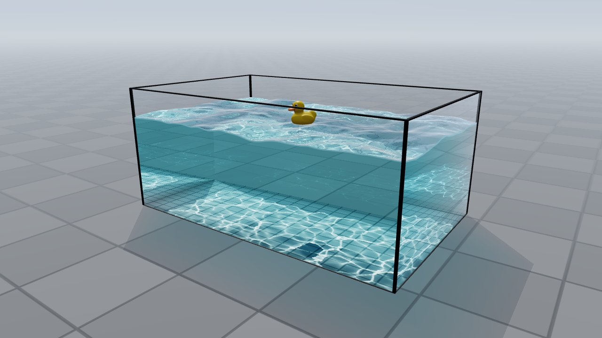
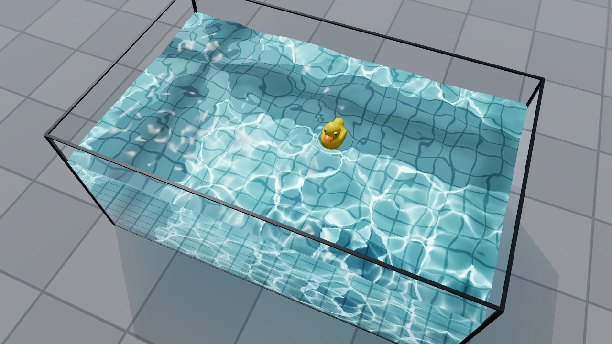
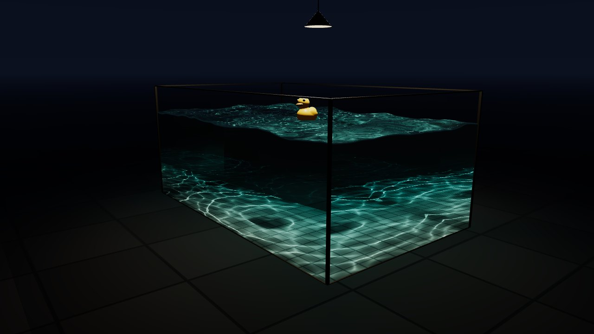
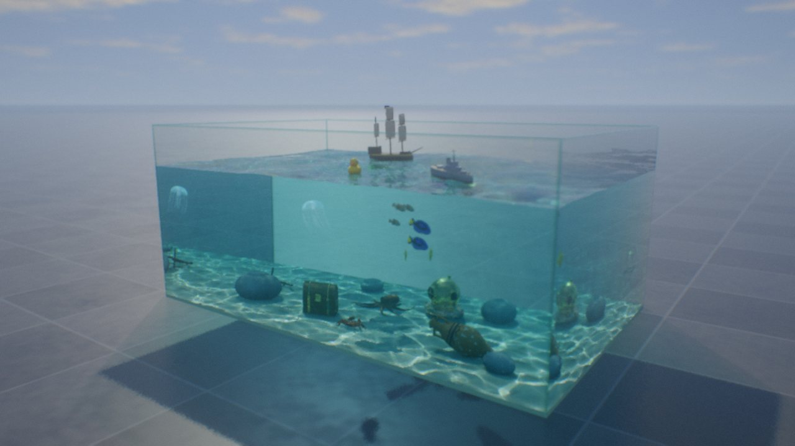
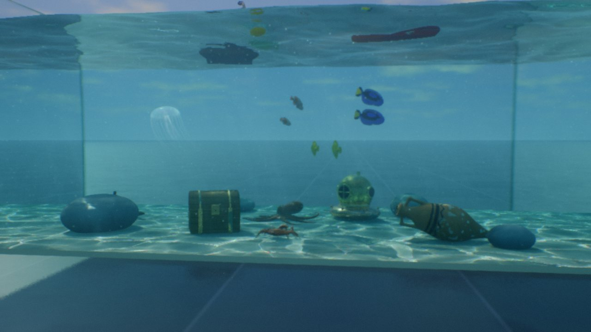
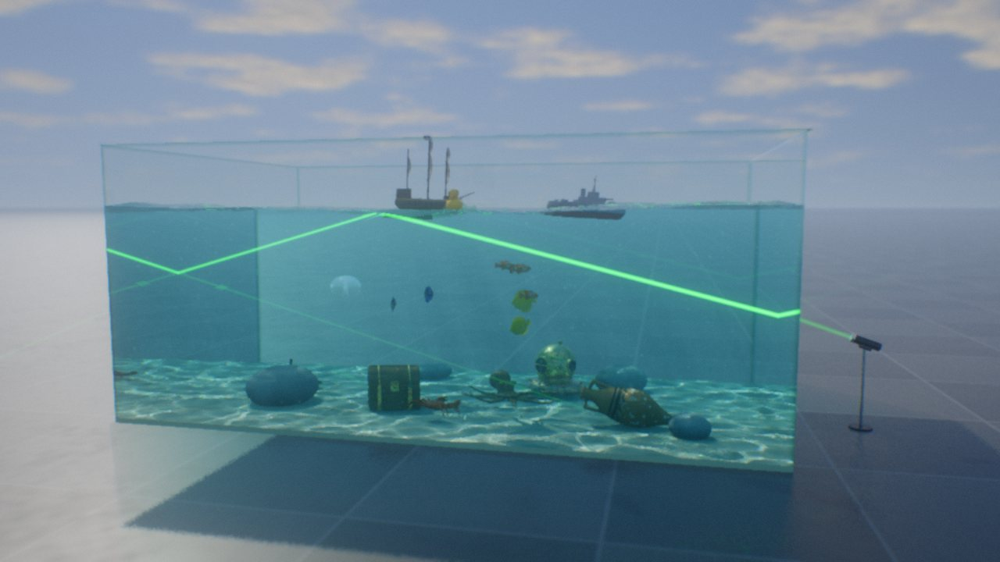
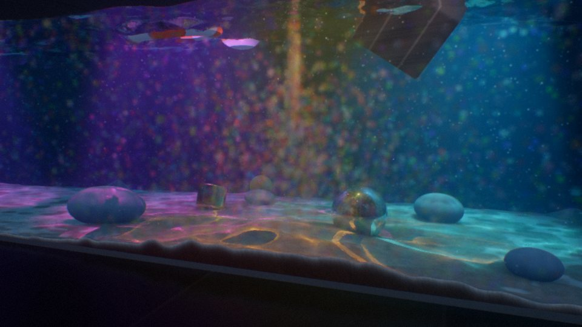

# CAUSTIC//VOLUME

Real-time water caustics in the browser, built on [three.js](https://threejs.org). Sunlight passes through a moving water surface, bends, and gathers into the bright, shifting lines you see on the bottom of a pool.

There are two versions. Each is a single HTML file with no install and no build step: open it and it runs. three.js (r186) loads from the jsDelivr CDN through an import map.



| | **CAUSTIC//LITE** | **CAUSTIC//VOLUME sandbox** |
|---|---|---|
| **Who it's for** | Anyone: old laptops, phones, school computers | People who want to push a high-end GPU |
| **Graphics** | three.js on WebGL 2, with a CPU fallback when there is no WebGL 2 (or no connection to load three.js) | three.js on WebGL 2 with float render targets |
| **Code** | [`lite/index.html`](lite/index.html), about 990 lines | [`sandbox/`](sandbox/), about 7,500 lines built from 18 source files |
| **In it** | A random sea, a rubber duck that makes ripples, sun or lamp, turbulence, click ripples, caustics | Everything in Lite, plus objects, creatures, ink, sand, up to three lamps, a laser and much more (see below) |
| **Live demo** | [Open Lite](https://ScottieFox.github.io/caustic-volume/lite/) | [Open the sandbox](https://ScottieFox.github.io/caustic-volume/sandbox/) |

## Run it

1. Download this repository: use **Code → Download ZIP** on GitHub, or `git clone` it.
2. Open `lite/index.html` or `sandbox/index.html` in a browser.

You don't need a server or an install. The first load needs an internet connection for three.js; your browser caches it after that. Offline, the lite version switches to its CPU renderer. If you'd rather serve the folder over HTTP, run `python3 -m http.server` in the repository folder and open http://localhost:8000.

---

## CAUSTIC//LITE

| | |
|---|---|
|  |  |

The small version has a glass tank of water with a rubber duck bobbing on it, the sun or a hanging lamp, and the light that the moving surface focuses onto the tank floor. It is written to be read. The whole program is one file, about 990 lines including comments.

**Controls**

| Input | Action |
|---|---|
| Drag | Orbit the camera |
| Scroll, or pinch on a touch screen | Zoom |
| Click or tap the water | Make a ripple; near the duck, it also pushes the duck |
| **Sun / Lamp**, or <kbd>L</kbd> | Light the tank with the sun or with a lamp hanging over it at night |
| **Rubber duck**, or <kbd>D</kbd> | Put the duck in the water or take it out |
| <kbd>R</kbd> | Random ripple |
| <kbd>Space</kbd> | Pause |
| <kbd>H</kbd> | Hide the panel |
| Sliders | Sun height and direction (or lamp height and position), wave height, turbulence (short waves, gusts and how lively the duck is) |

Add `?cpu` to the URL to force the CPU renderer, for example `lite/index.html?cpu`.

### How it works

- **A random sea.** Twenty-four travelling waves, from 1.2 m down to 12 cm long, head in every direction (spread by the golden angle, so waves of similar length never run side by side). Together they make a short-crested, random surface, like a real pool in a breeze. Its caustics form a net of bright cells, not the parallel stripes that waves all heading one way would draw. The wave heights are chosen so each size bends the light about equally, which puts the net's sharpest lines on the floor. Each wave's crests wander, and its height rises and falls on its own irregular cycle, so the net keeps reshaping. **Waves** scales them all; **Turbulence** adds the short ones.
- **Ripples and the rubber duck.** A ripple simulation runs on the GPU (the wave equation, stepped with three.js's `GPUComputationRenderer`). It carries your clicks, gusts that come faster with more turbulence, and the duck's wake across the tank and back off the glass. The duck drifts on a wandering breeze, sways with the waves and bobs on a spring. Each step, its hull pushes water aside: the difference between where the hull was and where it is now goes into the simulation, and spreads out as a wake and rings. The duck has the same shape as the sandbox's. Ellipsoids and a sphere make its body, tail, chest, head and wings, and a smooth minimum blends them into one rounded form (they are signed distance functions); a beak with a mouth line and two eyes finish it. While three.js loads, the page turns that shape into a smooth three.js mesh (with surface nets). Below the water, the shaders trace the same shape, and it casts a soft shadow into the caustics.
- **The water in three.js.** Once a frame, the sea and the ripples are drawn together into one texture of height and slope, which every shader reads. The surface is a mesh that this texture moves in its vertex shader. Its fragment shader reflects the sky (Fresnel's equations) and refracts the view into the water (Snell's law), then follows that ray to the floor or out through a glass wall. Past the critical angle, light inside the water reflects completely. The water absorbs red light faster than blue (Beer–Lambert), which gives it its colour. The water seen through the glass walls is a box whose shader does the same from the side and drops everything above the moving water line. The ground, sky, glass and frame are ordinary three.js meshes.
- **Caustics.** Every frame, each vertex of a fine grid on the surface sends one ray of light (from the sun, or from the lamp) through the water to the floor. The grid is then drawn where its rays land, into a caustics texture. A patch of surface whose light lands on a smaller patch of floor concentrates it, so each fragment gets the ratio of the two areas (from screen-space derivatives). Overlapping patches add up into the bright lines. Sunlight that enters through a glass wall below the water line is added on its own. See `causMesh` and `floorColor()` in the source.
- **Adaptive resolution.** The page watches its own frame rate and lowers or raises the render resolution to stay smooth, so it runs on an old laptop and on a phone.
- **CPU fallback.** If WebGL 2 is missing or three.js can't load (for example offline), the same scene, duck included, is traced in plain JavaScript on a 2D canvas, with the same waves and a coarser ripple simulation. To keep that fast, it samples the waves and caustics once per frame on small grids, renders at reduced resolution, and scales the image up.

---

## CAUSTIC//VOLUME (sandbox)

| | |
|---|---|
|  |  |
|  |  |

The full sandbox is for exploring and for pushing a GPU as hard as you like. It runs on three.js: one `WebGLRenderer` draws every pass, each simulation texture belongs to a `WebGLRenderTarget`, and each shader is a `RawShaderMaterial`. It includes:

- **Water.** An FFT ocean spectrum plus an interactive ripple simulation (iWave), foam, and splashes.
- **Light.** Photon-traced caustics on the floor, with colour dispersion. A caustic *volume* drives light shafts through the water. The tracer follows refraction and reflection through the water and the glass, including total internal reflection and Snell's window.
- **Things that float and sink.** Each object gets real buoyancy physics: a toy battleship, a pirate ship, a rubber duck, a message bottle, a treasure chest, an anchor, an amphora, a diver's helmet and more. You can set how many objects the tank holds before the oldest is replaced.
- **Creatures.** Schooling clownfish, blue tang and yellow tang; a pulsing jellyfish trailing long, swaying tentacles and frilly oral arms; an octopus whose tapering arms curl at the tips and carry two rows of suckers; and a crab that walks sideways on jointed legs.
- **Ink.** Coloured ink in a 3D fluid simulation that swirls with the water.
- **Sand.** Multicoloured sand that falls, settles and builds up in layers.
- **Stirring.** Drag through the water to stir it. Ink, sand and the specks floating in the water all follow the flow, and stirring near the bottom lifts sand off the bed.
- **Lamps.** Switch from the sun to one, two or three placeable lamps, each with its own colour.
- **Laser.** A solid beam that refracts at the water's mean level (so passing waves don't swing it about), reflects around the tank, and glows softly in the water's haze.
- **Quality presets.** Low to Insane, with temporal anti-aliasing, bloom and depth of field.

The panel lists every control, and every keyboard shortcut is shown at the bottom of the panel. Medium quality is the default. Raise it under **Quality**.

### Sandbox source

`sandbox/index.html` is built from the modules in [`sandbox/src/`](sandbox/src/):

| File | Contents |
|---|---|
| `00_head.html` | Page, styles and control panel |
| `10_sim.js` | FFT ocean, ripple simulation, surface |
| `20_caustic.js` | Photon tracing and caustic volume |
| `25_ink.js`, `65_sand.js`, `27_sand.js` | Ink fluid, sand simulation and rendering |
| `28_laser.js`, `66_laser.js` | Laser beam tree |
| `30_trace.js` | The main ray tracer |
| `40_post.js` | TAA, depth of field, bloom, tone mapping |
| `50_gl.js`, `55_resources.js` | The three.js layer (renderer, render targets, shader materials, readbacks) and GPU resources |
| `60_physics.js`, `62_models.js`, `63_creatures.js` | Buoyancy physics, object models, creatures |
| `67_particulate.js` | Specks suspended in the water that drift and follow the flow |
| `70_render.js`, `80_main.js` | Frame orchestration, UI and main loop |

After editing a module, rebuild the page with `node tools/build-sandbox.cjs`. You need Node 18 or newer and nothing else. The build joins the modules into one script and adds the import map and a few lines that load three.js and start the app.

---

## Browser support

- **Lite.** The three.js renderer needs WebGL 2, which every current desktop and mobile browser has (Safari since version 15). If WebGL 2 is off or unavailable, or three.js can't be loaded, it switches to the CPU renderer by itself. This matters more than it used to: since Chrome 141, Chrome no longer falls back to software WebGL on macOS and Linux machines without a working GPU.
- **Sandbox.** Needs WebGL 2 with `EXT_color_buffer_float`, which current Chrome, Edge, Firefox and Safari provide on desktop, and a capable GPU. If WebGL 2 isn't available, the page says so and points to the lite version.

## Project layout

```
caustic-volume/
├── index.html              landing page (GitHub Pages)
├── lite/index.html         CAUSTIC//LITE: the whole program
├── sandbox/
│   ├── index.html          CAUSTIC//VOLUME: built, ready to open
│   └── src/                its source modules
├── tools/
│   ├── build-sandbox.cjs   rebuilds sandbox/index.html from sandbox/src
│   ├── test-lite.cjs       headless check of the lite version
│   └── test-sandbox.cjs    headless check of the sandbox
├── docs/                   screenshots for this README
├── package.json
└── LICENSE
```

## Development

The two HTML files need nothing to run. The optional tests use [Playwright](https://playwright.dev) to open each version in headless Chromium on software WebGL, render several views to `shots/`, and fail on shader or page errors. `npm install` also fetches the same three.js release, and the tests serve it locally, so they run offline.

```bash
npm install
npx playwright install chromium
npm test                  # lite: GPU path (software WebGL)
npm run test:cpu          # lite: CPU fallback
npm run test:sandbox      # sandbox (slow on software rendering)
npm run build             # rebuild sandbox/index.html after editing sandbox/src
```

## Contributing

Issues and pull requests are welcome. Please keep each version a single HTML file on three.js, with nothing to install. Please also keep the lite version's CPU fallback working, and the file under 1,000 lines.

## License

[MIT](LICENSE). You can use, copy, modify and share this project, including commercially, at no cost. The only condition is that copies keep the copyright and license notice.
